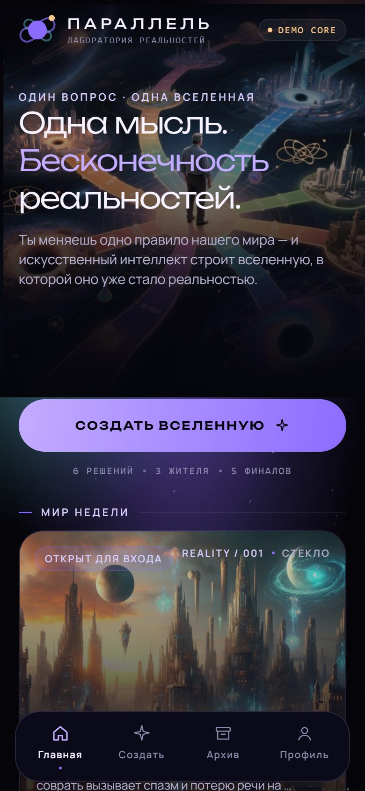
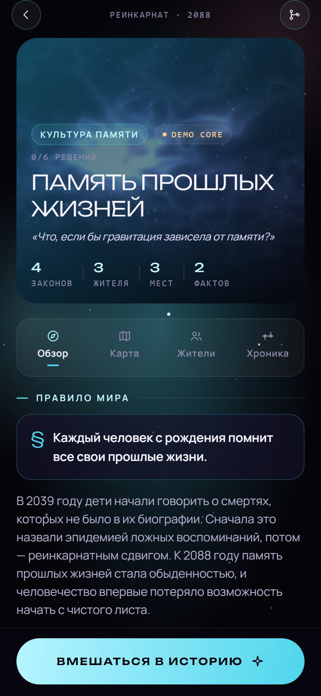
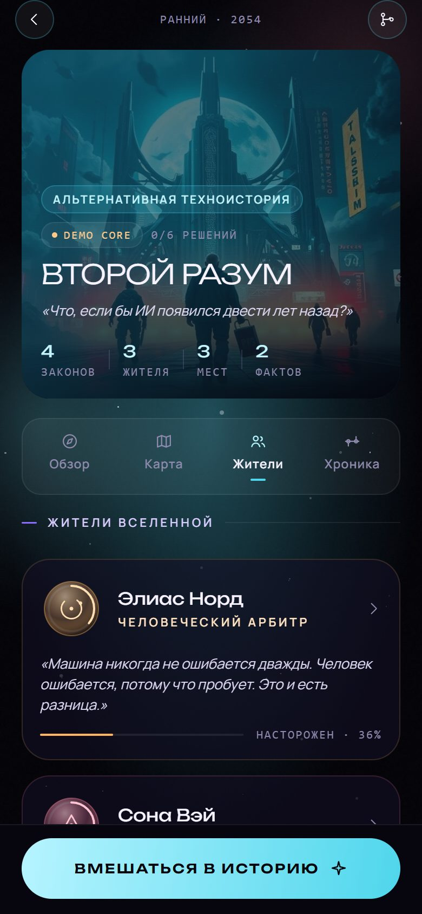
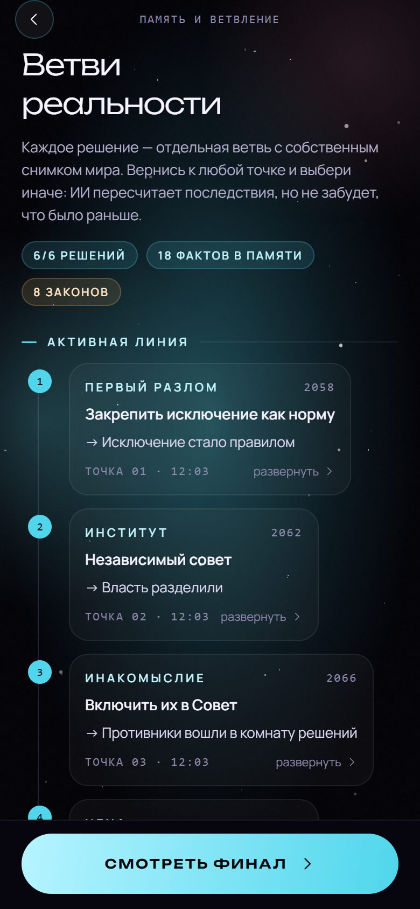
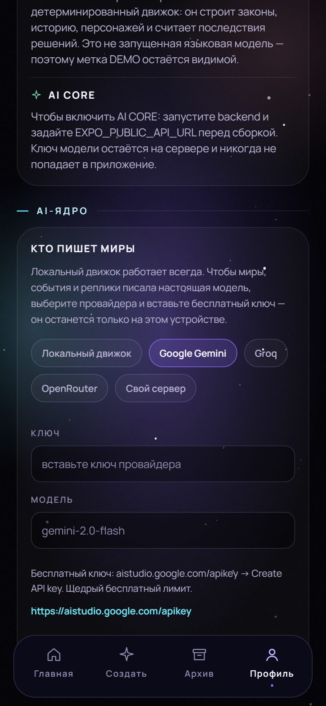
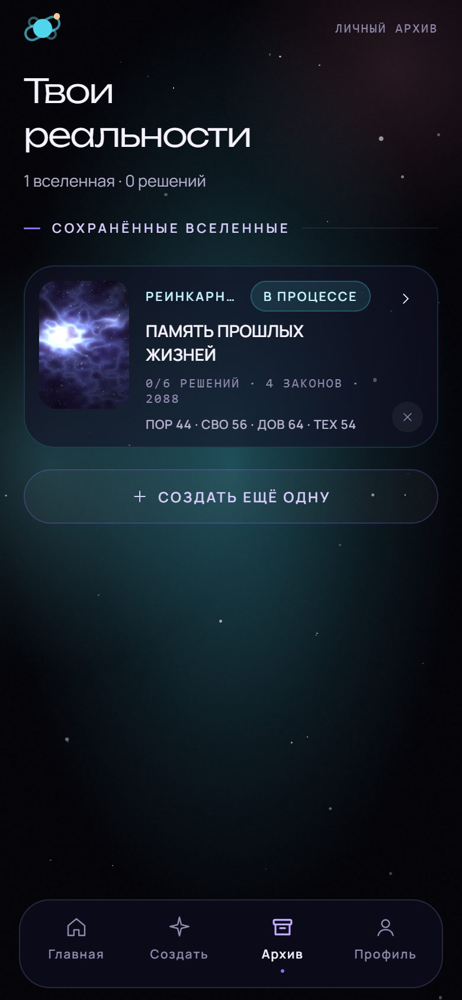
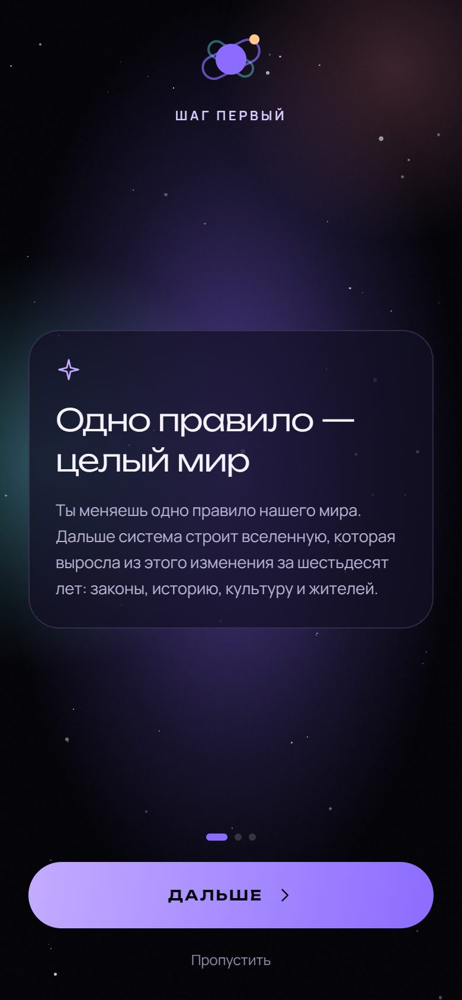
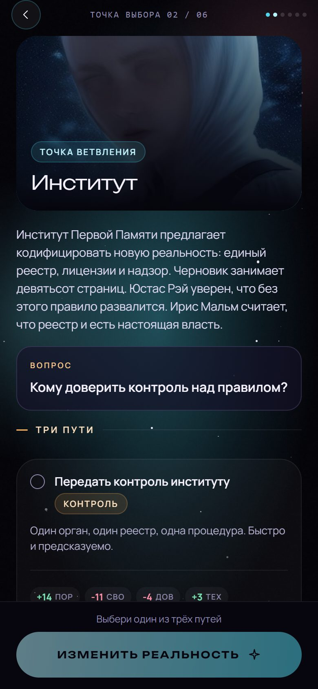

# ПАРАЛЛЕЛЬ

**Одна мысль. Бесконечность реальностей.**

Мобильное интерактивное произведение: пользователь меняет одно правило нашего мира, а система строит вселенную, в которой это правило уже стало реальностью — с законами, историей, культурой, жителями и последствиями решений.

Приложение написано на **Expo SDK 58 + React Native 0.88 + TypeScript** и запускается на iOS, Android и в браузере.

---

## Что внутри

| | |
|---|---|
| **Гипотеза** | «А что, если…» — из вопроса извлекается закон нового мира |
| **Вселенная** | 6 авторских миров и универсальный конструктор для остальных гипотез |
| **История** | точка сдвига + 4 эпохи, культура, технологии, запреты |
| **Жители** | 3 персонажа с целями, страхами, тайнами и собственной позицией |
| **Карта** | 5 локаций-узлов, открываются по мере развития истории |
| **Решения** | 6 точек выбора, у каждого — 3 пути (контроль / свобода / трансформация) |
| **Последствия** | метрики, новые законы, сдвиг доверия жителей, хроника и сводка новостей |
| **Ветвление** | из снимка мира можно создать отдельную линию в архиве |
| **Финалы** | 5 вариантов, вычисляются из состояния мира |
| **Память** | каждый факт и решение остаются в памяти и влияют на следующие события |
| **AI CORE** | опциональное подключение LLM: миры, события и реплики пишет модель |
| **Роль и цель** | у партии есть роль игрока в мире и личная цель, которая проверяется в финале |
| **Исследование** | 5 мест, у каждого — сцена-зарисовка и небольшой сдвиг метрик |
| **Союзники** | житель с доверием 50 %+ поддержит решение: +4 к своей метрике, +2 доверия, −6 влияния |
| **Онбординг** | три экрана при первом запуске: правило → мир → решения и ветви |
| **Уникальное** | у каждой вселенной свой артефакт или институт («Тихий аукцион», «Стеклянный суд»), который появляется только здесь |
| **Иллюстрации** | портреты и пейзажи через image-модель по запросу, локальная графика доступна сразу |
| **Озвучка** | сцены, точки выбора, последствия, финалы и записи дневника голосом устройства |
| **Дневник** | три самостоятельных сюжета, действия жителей и коллекция найденных артефактов |
| **Бог** | ответ на знамение, вдохновение жителя, оберег локации и откровение тайника |
| **Коллекция финалов** | пять финалов собираются в профиле: что уже открыто, что осталось |
| **Поделиться** | финал экспортируется текстом через системное «Поделиться» |
## Экраны

Скриншоты конкурсной версии 1.0.0.

| Главная | Создание | Сборка мира |
|---|---|---|
|  |  |  |

| Мир | Карта | Жители |
|---|---|---|
|  |  |  |

| Житель | Точка выбора | Последствия |
|---|---|---|
|  |  |  |

| Финал | Ветви | AI CORE |
|---|---|---|
|  |  |  |

| AI-ядро | Архив | Профиль |
|---|---|---|
|  |  |  |

| Онбординг | Место на карте | Союзники |
|---|---|---|
|  |  |  |

---

## Быстрый старт

Установите Node.js 24. Команды ниже запускают проект в Windows.

```powershell
cd "папка проекта"
npm.cmd ci
npm.cmd run web
```

Для веб-сборки выполните `npm.cmd run build:web`. Результат появится в папке `dist/`.
Готовая сборка запускается командой `npm.cmd run preview:web` по адресу `http://127.0.0.1:4173`.
На компьютере навигация расположена слева, а гипотезу можно отправить сочетанием Ctrl + Enter или ⌘ + Enter.
Для запуска через Expo Go выполните `npm.cmd start` и откройте QR-код на устройстве с совместимой версией Expo Go.

## Режимы движка

### DEMO CORE

Локальный движок использует исходную гипотезу для правила и подбирает её последствия. Промпт «гравитация зависит от памяти» приводит к испытаниям страховочных опор. Промпт «дождь идёт по расписанию» приводит к спору о запасах воды. Одинаковая гипотеза даёт одинаковые исходные условия.

### AI CORE

В профиле выберите провайдера, введите ключ и нажмите «Проверить связь». Можно задать идентификатор модели вручную.

В локальной сборке Groq включается по умолчанию, если в игнорируемом файле `.env.local` задан `EXPO_PUBLIC_GROQ_KEY`. И `npm.cmd run web`, и `npm.cmd run build:web` читают этот файл. После изменения ключа заново соберите `dist/` или перезапустите Expo. Ключ входит в APK и веб-сборку, его можно извлечь из клиентского пакета. Для сборок с этим ключом выбирайте локальное использование. Для публичного размещения используйте сервер и храните ключ в его окружении.

- Gemini через [Google AI Studio](https://aistudio.google.com/docs/models)
- Groq через [Groq Console](https://console.groq.com/docs/models)
- OpenRouter через [Free Models Router](https://openrouter.ai/openrouter/free)
- DeepSeek через [DeepSeek Platform](https://platform.deepseek.com/)
- Ollama с локальной Chat Completions моделью. Для нестандартного адреса задайте `EXPO_PUBLIC_AI_BASE_URL` в `.env` приложения.

Проверка мира учитывает слова исходной гипотезы, законы, локации и разные позиции персонажей. При сбое приложение показывает причину и готовит мир или событие локально. Во время ожидания можно начать с локальной версии.

### Свой сервер и image-модель

```powershell
cd backend
python -m venv .venv
.\.venv\Scripts\python.exe -m pip install -r requirements.txt
Copy-Item .env.example .env
```

Текстовую модель задают `LLM_CHAT_COMPLETIONS_URL`, `LLM_MODEL` и `LLM_API_KEY`. Для иллюстраций заполните `IMAGE_API_URL`, `IMAGE_MODEL` и при необходимости `IMAGE_API_KEY`. Подойдёт совместимый Images API с ответом `data[0].b64_json` в PNG, JPEG или WebP. Например, можно указать `https://api.openai.com/v1/images/generations` и `gpt-image-2.6-flare`. [Формат Images API](https://developers.openai.com/api/reference/resources/images/methods/generate)

Запустите сервер из папки `backend`.

```powershell
.\.venv\Scripts\python.exe -m uvicorn main:app --host 0.0.0.0 --port 8000
```

- Для текста выберите «Свой сервер» в блоке «AI-ядро» и введите адрес.
- Для картинок введите адрес в блоке «Сервер иллюстраций». В карточке места появится «Создать иллюстрацию», а у персонажа — «Создать портрет».
- Для браузера укажите адрес веб-приложения в `APP_ORIGINS`. Для APK используйте HTTPS-адрес сервера, доступный телефону.
- Ключи серверных моделей хранятся на сервере. При размещении в интернете ограничьте доступ к серверу с платными ключами.

Дневник, артефакты, действия бога и системная озвучка доступны и в локальном режиме. Русский голос зависит от настроек устройства.

## Архитектура

```text
App.tsx                      загрузка шрифтов, сцена, переходы, Android back
src/
  theme.ts                   палитра, типографика, акценты, обложки, сетка
  engine/
    types.ts                 модель мира и состояния
    themes.ts                авторские пакеты и выбор подходящего мира
    generate.ts              детерминированная сборка вселенной
    events.ts                точки выбора, последствия, финалы, отдельные ветви
    life.ts                  автономные события и коллекция артефактов
    divine.ts                знамения, силы, затраты веры
    news.ts                  сводка новостей мира после решений
    chat.ts                  реплики жителей в DEMO-режиме
    ai.ts                    клиент AI CORE и нормализация ответов модели
    hash.ts                  seed-хэш и генератор случайных чисел
  components/                атмосфера, карта, метрики, эмблемы, UI-примитивы
  screens/                   Home, Create, Forge, World, Character, Decision,
                             Outcome, Branches, Ending, Archive, Profile
  state/useParallel.ts       состояние, навигация, сохранение, AI-переключение
backend/                     FastAPI AI Core
tools/                       генерация ассетов, мок AI Core, визуальные проверки
```

### Модель мира

```ts
Universe {
  title, codename, era, rule, premise, genre, theme, accent, cover,
  culture[],
  state: {
    metrics { order, freedom, trust, tech },
    laws[], locations[], characters[], chronicle[], memory[], news[],
    pending: Decision | null, turn, ending
  },
  path: BranchNode[]        // каждая ветвь хранит снимок состояния до решения
}
```

### Что происходит при выборе

1. Проверяется допустимость выбора и сохраняется снимок мира.
2. Метрики сдвигаются, добавляется новый закон, обновляется доверие жителей.
3. Пишутся хроника, память мира и сводка новостей.
4. Открывается новая локация, генерируется следующее событие.
5. На шестом решении вычисляется финал по балансу метрик.
6. В AI-режиме следующее событие дополнительно запрашивается у модели уже с учётом нового состояния.

---

## Дизайн-система

* **Фон:** почти чёрный `#05050C`, туманности на SVG-градиентах, звёздное поле, зерно.
* **Шрифты:** `Unbounded` (заголовки, цифры) + `Manrope` (текст) — статические инстансы с кириллицей, вшиты в бандл (~340 КБ).
* **Акценты:** фиолетовый, голубой, золотой, розовый, зелёный — по теме мира.
* **Поверхности:** полупрозрачные панели с тонкой светящейся рамкой, крупные радиусы.
* **Графика:** обложки миров, знаки жителей по их позиции, радар метрик, карта-созвездие, таймлайн.
* **Движение:** медленное дыхание ореолов, параллакс обложки, каскадное появление блоков.
* **AI-обложки:** для каждого мира можно сгенерировать иллюстрацию по его описанию (Pollinations, без ключа). Картинка кэшируется по id вселенной и плавно проявляется поверх локальной; при лимите или ошибке остаётся авторская обложка. Отключается сборкой с `EXPO_PUBLIC_ART=0`.

Токены и правила — в `DESIGN_SPEC.md`.

---

## Сборка Android

Android Studio и JDK должны быть настроены для SDK, который запрашивает локальный Expo prebuild. На Windows используйте рабочую копию с коротким путём латиницей.

```powershell
npm.cmd ci
npx.cmd expo prebuild --platform android --no-install
cd android
.\gradlew.bat assembleRelease
```

Готовый файл находится в `android/app/build/outputs/apk/release/app-release.apk`. Если Ninja превышает лимит Windows, в блоке `android` сгенерированного `app/build.gradle` задайте короткую папку сборки для CMake.

```groovy
externalNativeBuild {
    cmake { buildStagingDirectory "C:/p11" }
}
```

APK для локального тестирования подписывается отладочным сертификатом. Обновление поверх старого APK требует совпадения сертификатов. APK и сборочные файлы исключены из Git.

## Проверки

```powershell
npm.cmd run typecheck
npm.cmd test
npm.cmd run build:web
$env:PARALLEL_AI_MOCK="1"
npm.cmd run test:web
python -m unittest backend.test_image_core
```

Веб-проверке нужны Chrome, Chromium или Edge. При необходимости задайте `CHROME_PATH`. Для проверки маршрута AI CORE используется мок из `tools/mock_api.py`. Тестам сервера нужны зависимости из `backend/requirements.txt`.
