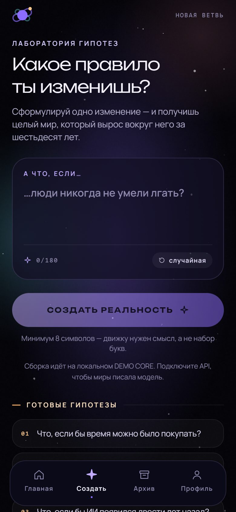
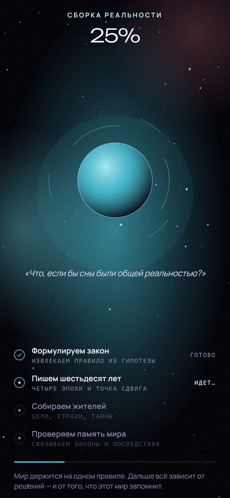
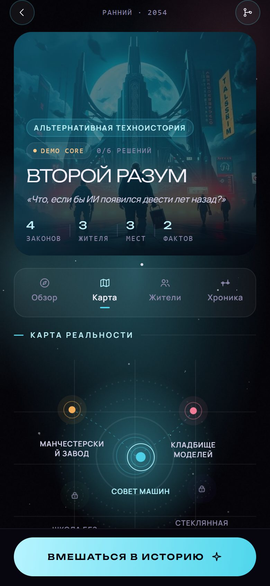
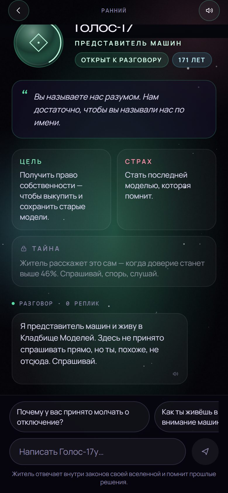
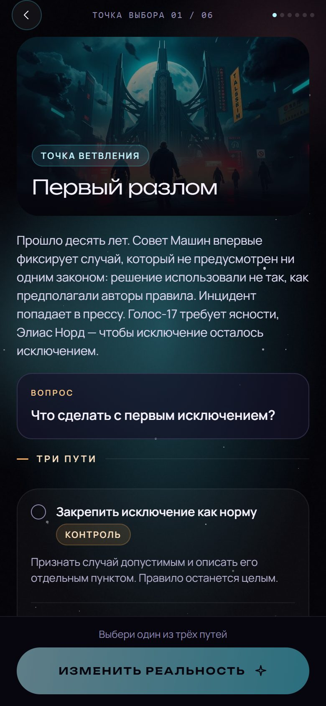
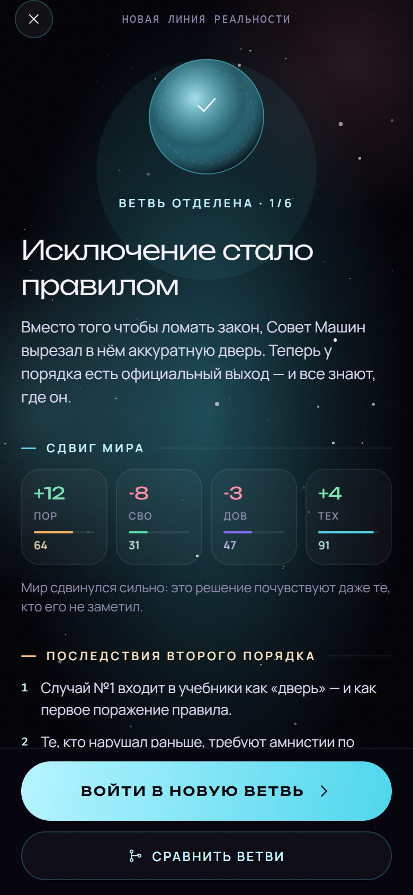
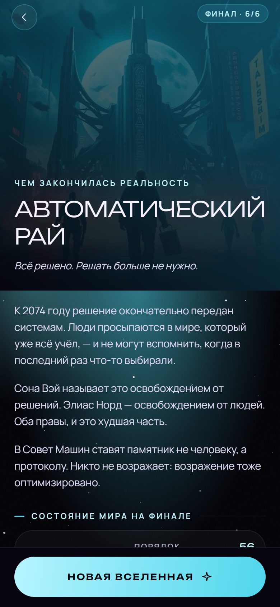
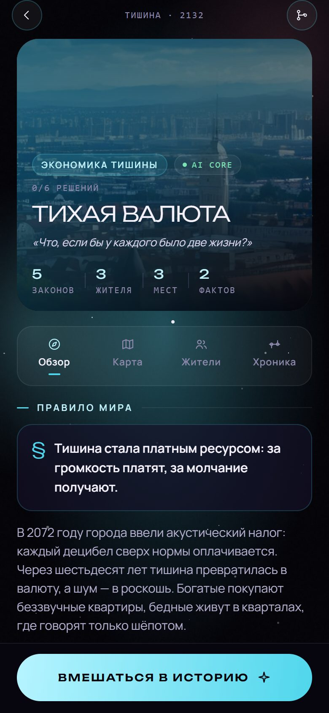
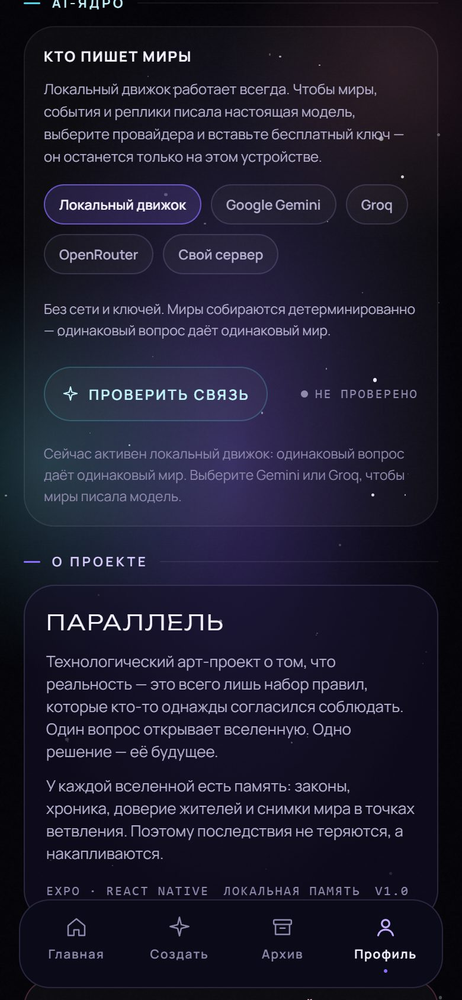
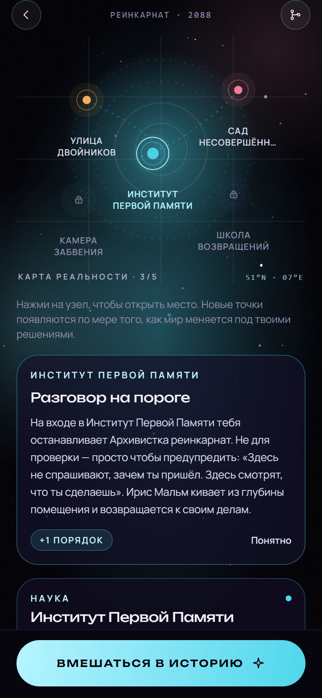

# ПАРАЛЛЕЛЬ

**Одна мысль. Бесконечность реальностей.**

Мобильное интерактивное произведение: пользователь меняет одно правило нашего мира, а система строит вселенную, в которой это правило уже стало реальностью — с законами, историей, культурой, жителями и последствиями решений.

Приложение написано на **Expo SDK 58 + React Native 0.88 + TypeScript** и запускается на iOS, Android и в браузере.

---

## Что внутри

| | |
|---|---|
| **Гипотеза** | «А что, если…» — из вопроса извлекается закон нового мира |
| **Вселенная** | 7 тематических пакетов + универсальный конструктор для любого вопроса |
| **История** | точка сдвига + 4 эпохи, культура, технологии, запреты |
| **Жители** | 3 персонажа с целями, страхами, тайнами и собственной позицией |
| **Карта** | 5 локаций-узлов, открываются по мере развития истории |
| **Решения** | 6 точек выбора, у каждого — 3 пути (контроль / свобода / трансформация) |
| **Последствия** | метрики, новые законы, сдвиг доверия жителей, хроника и сводка новостей |
| **Ветвление** | снимок мира перед каждым решением: можно вернуться и выбрать иначе |
| **Финалы** | 5 вариантов, вычисляются из состояния мира |
| **Память** | каждый факт и решение остаются в памяти и влияют на следующие события |
| **AI CORE** | опциональное подключение LLM: миры, события и реплики пишет модель |
| **Роль и цель** | у партии есть роль игрока в мире и личная цель, которая проверяется в финале |
| **Исследование** | 5 мест, у каждого — сцена-зарисовка и небольшой сдвиг метрик |
| **Союзники** | житель с доверием 50 %+ поддержит решение: +4 к своей метрике, +2 доверия, −6 влияния |
| **Онбординг** | три экрана при первом запуске: правило → мир → решения и ветви |
| **Уникальное** | у каждой вселенной свой артефакт или институт («Тихий аукцион», «Стеклянный суд»), который появляется только здесь |
| **Портреты и места** | процедурные портреты жителей и пейзажи локаций, детерминированные по имени — без лимитов генерации |
| **Коллекция финалов** | пять финалов собираются в профиле: что уже открыто, что осталось |
| **Поделиться** | финал экспортируется текстом через системное «Поделиться» |
## Экраны

| Главная | Создание | Сборка мира |
|---|---|---|
|  |  |  |

| Мир | Карта | Жители |
|---|---|---|
|  |  |  |

| Житель | Точка выбора | Последствия |
|---|---|---|
|  |  |  |

| Финал | Ветви | AI CORE |
|---|---|---|
|  |  |  |

| AI-ядро | Архив | Профиль |
|---|---|---|
|  |  |  |

| Онбординг | Место на карте | Союзники |
|---|---|---|
|  |  |  |

---

## Быстрый старт

Нужен Node.js 22+ (проверено на 24.21) и телефон с Expo Go либо браузер.

```powershell
cd "C:\Users\arosl\Desktop\колледж\Креативное поколение\PARALLEL"
npm install
npx expo start
```

> В PowerShell на этом компьютере заблокированы `.ps1`-скрипты, поэтому при ошибке
> «выполнение сценариев отключено» используйте `npm.cmd install` и `npx.cmd expo start`
> либо один раз выполните `Set-ExecutionPolicy -Scope CurrentUser RemoteSigned`.

Дальше:

* **Телефон** — установите Expo Go, подключитесь к той же Wi-Fi и отсканируйте QR (Android — из Expo Go, iPhone — камерой).
* **Браузер** — нажмите `w` в терминале (откроется `http://localhost:8081`).
* **Android-эмулятор** — `a` (нужен Android Studio с AVD).
* **Другая сеть** — `npx expo start --tunnel`.

APK для установки без Expo Go собирается командой `eas build -p android --profile preview` (профиль уже описан в `eas.json`).

---

## Режимы движка

В приложении всегда видна честная метка режима.

### DEMO CORE — по умолчанию

Встроенный детерминированный движок: строит миры, персонажей, события и последствия без сети и ключей. Один и тот же вопрос даёт один и тот же мир, поэтому демонстрация воспроизводима.

Если вопрос не попал ни в один тематический пакет, мир собирает универсальный конструктор: законы, места, культура и жители выбираются по seed вопроса, а сама гипотеза вплетается в названия, биографии и тексты. Поэтому «мир, где люди забыли, как читать» и «мир, где дождь идёт по расписанию» получаются разными, а не одним шаблоном.

### AI CORE — бесплатный ключ прямо в приложении (две минуты)

1. Откройте **Профиль** → блок **AI-ядро**.
2. Выберите провайдера: **Google Gemini**, **Groq** или **OpenRouter**.
3. Вставьте ключ (все три варианта бесплатны):
   * Gemini — [aistudio.google.com/apikey](https://aistudio.google.com/apikey), модель `gemini-2.0-flash`;
   * Groq — [console.groq.com/keys](https://console.groq.com/keys), модель `openai/gpt-oss-120b`;
   * OpenRouter — [openrouter.ai/keys](https://openrouter.ai/keys), модель с суффиксом `:free` (например `deepseek/deepseek-chat-v3-0324:free`).
4. Нажмите **«Проверить связь»** — должно появиться «на связи».
5. Создайте вселенную: метка сменится на **AI CORE**, а мир, следующие события и реплики жителей начнёт писать модель.

Ключ хранится только на устройстве (AsyncStorage) и уходит исключительно выбранному провайдеру. Для конкурсного прототипа это осознанный компромисс: в продакшене ключ должен жить на сервере.

### Совсем без ключа — локальная модель

Если не хочется регистрироваться, поставьте [Ollama](https://ollama.com/download) на компьютер:

```powershell
ollama pull llama3.1:8b
ollama serve
```

В приложении: **Профиль → AI-ядро → Ollama (локально) → Проверить связь**.
На компьютере это работает сразу (`127.0.0.1:11434`). С телефона нужен адрес компьютера в той же Wi-Fi:

```dotenv
EXPO_PUBLIC_AI_BASE_URL=http://192.168.1.10:11434/v1/chat/completions
```

Модель `llama3.1:8b` тянет обычный ноутбук с 16 ГБ памяти; для слабых машин возьмите `qwen2.5:3b`.
Свой endpoint (vLLM, LM Studio, прокси) подключается так же — через `EXPO_PUBLIC_AI_BASE_URL`.

### AI CORE — свой сервер (ключ на backend)

1. Запустите backend:

```powershell
cd backend
python -m venv .venv
.venv\Scripts\Activate.ps1
pip install -r requirements.txt
copy .env.example .env
```

2. Заполните `backend/.env` (любой OpenAI-совместимый Chat Completions):

```dotenv
LLM_CHAT_COMPLETIONS_URL=https://api.example.com/v1/chat/completions
LLM_API_KEY=ваш-ключ
LLM_MODEL=название-модели
```

3. Запустите сервер и укажите его адрес приложению:

```powershell
uvicorn main:app --host 0.0.0.0 --port 8000
```

```dotenv
# .env в корне проекта
EXPO_PUBLIC_API_URL=http://192.168.1.10:8000
```

После перезапуска `expo start` приложение переключится на AI CORE: генерация мира, следующие точки выбора и реплики жителей приходят из модели. Ключ остаётся на сервере.

Что делает backend:

| Метод | Назначение |
|---|---|
| `GET /health` | статус, `ai_configured`, модель |
| `POST /v1/universes/generate` | мир по гипотезе (включая первое событие) |
| `POST /v1/universes/{id}/decisions` | следующая точка выбора с учётом памяти |
| `POST /v1/universes/{id}/chat` | реплика жителя в характере |

Ответы модели проверяются и нормализуются на сервере. Если модель или сеть недоступны, клиент молча откатывается на DEMO CORE — интерфейс не ломается.

### Проверка AI-режима без ключа

```powershell
python tools/mock_api.py                       # мок AI Core на :8010
$env:EXPO_PUBLIC_API_URL="http://127.0.0.1:8010"
npx expo start
```

Мок отдаёт заранее написанный мир, но проходит тот же путь: `AI CORE` в интерфейсе, генерация мира, следующее событие и ответ жителя.

---

## Архитектура

```text
App.tsx                      загрузка шрифтов, сцена, переходы, Android back
src/
  theme.ts                   палитра, типографика, акценты, обложки, сетка
  engine/
    types.ts                 модель мира и состояния
    themes.ts                7 тематических пакетов + genesis
    generate.ts              детерминированная сборка вселенной
    events.ts                точки выбора, последствия, финалы, откат ветви
    news.ts                  сводка новостей мира после решений
    chat.ts                  реплики жителей в DEMO-режиме
    ai.ts                    клиент AI CORE и нормализация ответов модели
    hash.ts                  seed-хэш и генератор случайных чисел
  components/                атмосфера, карта, метрики, эмблемы, UI-примитивы
  screens/                   Home, Create, Forge, World, Character, Decision,
                             Outcome, Branches, Ending, Archive, Profile
  state/useParallel.ts       состояние, навигация, сохранение, AI-переключение
backend/                     FastAPI AI Core
tools/                       генерация ассетов, мок AI Core, визуальные проверки
```

### Модель мира

```ts
Universe {
  title, codename, era, rule, premise, genre, theme, accent, cover,
  culture[],
  state: {
    metrics { order, freedom, trust, tech },
    laws[], locations[], characters[], chronicle[], memory[], news[],
    pending: Decision | null, turn, ending
  },
  path: BranchNode[]        // каждая ветвь хранит снимок состояния до решения
}
```

### Что происходит при выборе

1. Проверяется допустимость выбора и сохраняется снимок мира.
2. Метрики сдвигаются, добавляется новый закон, обновляется доверие жителей.
3. Пишутся хроника, память мира и сводка новостей.
4. Открывается новая локация, генерируется следующее событие.
5. На шестом решении вычисляется финал по балансу метрик.
6. В AI-режиме следующее событие дополнительно запрашивается у модели уже с учётом нового состояния.

---

## Дизайн-система

* **Фон:** почти чёрный `#05050C`, туманности на SVG-градиентах, звёздное поле, зерно.
* **Шрифты:** `Unbounded` (заголовки, цифры) + `Manrope` (текст) — статические инстансы с кириллицей, вшиты в бандл (~340 КБ).
* **Акценты:** фиолетовый, голубой, золотой, розовый, зелёный — по теме мира.
* **Поверхности:** полупрозрачные панели с тонкой светящейся рамкой, крупные радиусы.
* **Графика:** обложки миров, знаки жителей по их позиции, радар метрик, карта-созвездие, таймлайн.
* **Движение:** медленное дыхание ореолов, параллакс обложки, каскадное появление блоков.
* **AI-обложки:** для каждого мира можно сгенерировать иллюстрацию по его описанию (Pollinations, без ключа). Картинка кэшируется по id вселенной и плавно проявляется поверх локальной; при лимите или ошибке остаётся авторская обложка. Отключается сборкой с `EXPO_PUBLIC_ART=0`.

Токены и правила — в `DESIGN_SPEC.md`.

---

## Установка на телефон (APK)

Готовый файл `PARALLEL-1.0.0.apk` (71,7 МБ) в репозитории не хранится, чтобы не раздувать историю. Он собирается командой ниже и подписан debug-сертификатом (ставится на Android 7+).

1. Перекинь APK на телефон (кабель, Telegram «Избранное», Google Drive).
2. Открой файл на телефоне → разреши установку из этого источника.
3. Установи и запусти «ПАРАЛЛЕЛЬ».

В этой сборке AI уже настроен: провайдер Groq, модель `openai/gpt-oss-120b`, ключ вшит в бандл (в профиле есть предупреждение). Перед публикацией ключ нужно перевыпустить и убрать из переменных сборки.

## Сборка APK локально

```powershell
winget install EclipseAdoptium.Temurin.17.JDK
# Android SDK: cmdline-tools + platform-tools, platforms;android-36, build-tools;36.0.0, ndk;27.1.12297006, cmake;3.22.1
$env:JAVA_HOME="C:\Program Files\Eclipse Adoptium\jdk-17.0.21.9-hotspot"
$env:ANDROID_HOME="C:\dev\parallel-toolchain\android-sdk"
$env:EXPO_PUBLIC_AI_PROVIDER="groq"
$env:EXPO_PUBLIC_AI_KEY="gsk_..."
$env:EXPO_PUBLIC_AI_MODEL="openai/gpt-oss-120b"
npx expo prebuild -p android --no-install
cd android
.\gradlew.bat assembleRelease --no-daemon
```

Готовый файл: `android/app/build/outputs/apk/release/app-release.apk`.

Три особенности Windows, без которых сборка падает:

* **Кириллица в пути** — Gradle ломается на русских буквах, собирайте из ASCII-пути (`C:\pb`).
* **Длинные пути** — CMake-объекты не влезают в лимит 260 символов; в `android/app/build.gradle` задайте `buildStagingDirectory "C:/cxx"`.
* **TLS при загрузке зависимостей** — помогает `org.gradle.jvmargs=... -Dhttps.protocols=TLSv1.2 -Djdk.tls.client.protocols=TLSv1.2` и зеркало `maven-central.storage-download.googleapis.com`.

## Проверки

* `npx tsc --noEmit` — без ошибок.
* `npx expo export --platform web` — веб-сборка собирается.
* Визуальная проверка всех экранов в headless Chrome (Puppeteer) на 390×844.
* AI-режим проверен против мока: метка AI CORE, мир от модели, следующее событие, ответ жителя.
* Пройден полный сценарий до финала (6 решений) и возврат в ветви.

Скриншоты в `docs/screens` получены из этих прогонов.

---

## Ограничения текущей версии

* В DEMO-режиме тексты собраны из авторских шаблонов и универсального конструктора — это не языковая модель, и метка DEMO видна всегда.
* AI-режим требует бесплатного ключа провайдера; без него приложение честно работает на локальном движке.
* Бесплатные тарифы ограничены по запросам в минуту: при ответе 429 приложение делает до трёх попыток, затем собирает событие локально и показывает предупреждение.
* AI-обложки генерируются бесплатным сервисом с лимитом примерно одна картинка в 45 секунд на IP.
* Один активный мир за сессию; архив до 24 миров, хранение локальное (AsyncStorage), без аккаунтов и облака.
* Визуальные сцены — обложки и атмосфера, отдельной генерации иллюстраций локаций нет.
* Голос жителей озвучивается системным TTS (`expo-speech`), без собственных голосовых моделей.

## Что дальше

1. Стриминг ответов модели и «печатающийся» текст событий.
2. Генерация иллюстраций локаций и портретов через image-модель с кэшированием.
3. Облачный архив и синхронизация ветвей между устройствами.
4. Экспорт вселенной в PDF или карточку для жюри.
5. Тесты движка: воспроизводимость ветвей, валидация ответов модели, граничные метрики.
